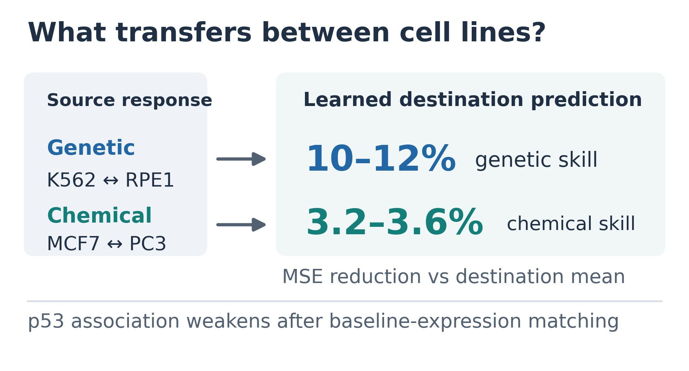

# ICE-PRN

**What transfers between cell lines? Comparator-explicit evaluation of perturbation response prediction.**

This repository accompanies the draft manuscript and reproduces its four main and three supplementary figures from saved estimates. It compares copying, per-gene affine prediction and cross-gene prediction across genetic K562↔RPE1 and chemical MCF7↔PC3 perturbations.

Learning improves held-out prediction beyond the destination training mean. Independent annotations test whether the gain aligns with known biology. Predictive improvement does not identify a regulatory mechanism.



## Rebuild every figure

From this directory, in your Python environment:

```bash
python -m pip install -r requirements.txt
python verify_release.py
python figure_runner/build_all.py
python toc/build_toc.py
```

Outputs: `figure_runner/figures/` (Figures 1–4 and S1–S3, each PNG/PDF/SVG) and `toc/`. The renderer validates frozen inputs. It does not refit models or rerun bootstrap inference. Use `python figure_runner/build_all.py --out /path/to/new_folder` for a separate figure destination. Dependencies: Python 3.10 or later, NumPy, pandas and matplotlib.

## Where to start

| Path | Contents |
|---|---|
| `paper/` | Current manuscript and Supporting Information drafts |
| `figure_runner/Figure_captions.md` | Current legends |
| `figure_runner/source_data/` | Derived source tables and provenance |
| `figure_runner/inputs/` | Frozen figure inputs and included mapping records |
| `analysis_packages/` | Original analysis runners with their own contracts and data requirements |
| `toc/` | TOC artwork and rebuild script |
| `docs/REPRODUCIBILITY.md` | What can and cannot be reproduced from this release |
| `docs/RELEASE_NOTES.md` | Current scope and changes |

## Read the results with their comparators

Skill is `1 − MSE(model) / MSE(comparator)`. The main comparator is the destination training mean; zero tests predicting no response. Whole interventions are held out, and opposite technical halves are used for scoring. Technical splits do not establish biological replication.

The p53 target-annotation association attenuates after matching on untreated expression; incomplete balance and overlap leave the association beyond expression unresolved. Program contrasts and chemical-pathway results include mixed outcomes and inadequate matching. Capacity in a source-variance basis is not biological dimensionality. The ribosomal-target follow-up is exploratory and does not establish p53 mediation. See the legends and SI for endpoint families and conditional uncertainty.

## Status, citation and rights

Research snapshot: 23 October 2026; figure layout v5.12. The manuscript is a draft with author/submission details still to finalize. No publication DOI or permanent software identifier has been assigned in this release; cite the paper after publication and the exact repository commit used.

Original ICE-PRN code and software documentation are available under the [MIT License](LICENSE). This license does not relicense manuscript text, third-party code, datasets or annotation snapshots; those retain their applicable rights, terms and attribution. `figure_runner/SOURCES.md` and the manuscript references identify data and annotation sources.

Candidate discovery, CARNIVAL, treatment ranking and the paused T-cell branch are outside this release. Older research outputs are retained as history, not promoted to current conclusions.
